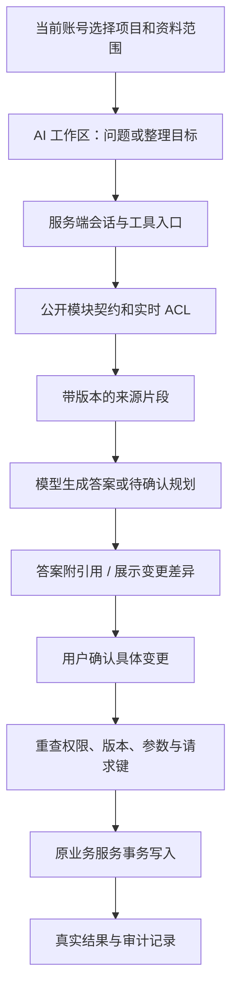

# 后续路线图

当前正式版为 **0.5.0**。已实现能力统一见 [DESIGN](DESIGN.md)，发布结果见 [Release](https://github.com/RETEMPT/AgileNest/releases/tag/v0.5.0) 与 [UX](UX.md)。本页只维护未完成事项；列出方案不代表获准实现，不建立空模块或假功能。

## 优先顺序

2026-10-20 项目评估建议先收口当前候选的发布验收、首次使用引导、跨页面一致性与对外部署检查，再扩展下表中的功能。依据和具体完成信号见 [项目评估](PR-RESEARCH.md#项目评估与登录视觉--2026-10-20)；本轮只授权登录展示重构，未授权实施额外业务或认证改造。

| 顺序 | 未完成事项 | 开始前明确 |
|---|---|---|
| 1 | 日历与任务视图的筛选一致性；里程碑业务写入契约测试；自动截止扫描测试 | 实际缺口、可见日期范围与现有 URL 兼容；里程碑图与页面读取测试已补，不等于覆盖全部写入 |
| 2 | 自动截止提醒、飞书业务投递、系统 Web Push | 用户选择、凭据、幂等/重试、离队撤权、投递失败不影响任务 |
| 3 | 文档实时共同编辑 | 编辑协议、ACL、离线恢复、历史快照与 Windows 运行环境 |
| 4 | 异步群聊与离线同步，再评估在线通信 | 独立会话权限、消息历史、附件权限、已读与留存范围 |
| 5 | 独立会议与行动项管理 | 参会成员、日期/纪要、行动项来源与私人日程隔离 |
| 6 | GitHub/飞书外部同步 | 可选连接、映射、权限、Webhook 验签与冲突；非代码项目仍可完整使用 |

文档/会议摘录创建任务、本人日程提醒、站内通知、标签/依赖和阶段交付已经实现，不作为以上功能的替代品。项目日历不能据此宣称支持看板的全部筛选；会议记录目前是项目文档。

## 教学协作创新候选（未实施）

优先考虑对既有数据的增强：资料—要求—提交—评审—交付的只读证据链、用户主动启动的提交前证据体检、基于真实里程碑产出的汇报草稿，以及可以展开到具体任务的贡献解释。详细取舍见 [项目评估](PR-RESEARCH.md#项目评估与登录视觉--2026-10-20)。这些方向不新增成绩、作品集、甘特或 Sprint；AI 不代替教师验收，也不根据数量给成员能力或诚信评分，开始前仍须登记相应 Owner 与公开契约。

## 实时共同编辑方案（未实施）

现有文档采用全文版本检查和 409 冲突。实时编辑需另建编辑会话、参与者权限、操作审计和同步协议；CRDT/操作同步依赖、许可证及 Windows 运行环境先评估。已发布文档快照继续作为任务来源和验收证据，实时草稿不能直接替代证据版本。

- 握手与每批写入重查文档 ACL，离队或撤销编辑权后停止写入。
- 消息包含 docId/sessionId/clientId/sequence/baseRevision；服务器去重并保存可重放操作。
- 重连协商服务器序号/快照，再补发离线队列，禁止旧全文覆盖新内容；失败显示未同步，提供草稿复制/导出。
- 限制参与人数、操作大小、速率及留存期限；定期快照仍保留被引用版本。
- 验收覆盖并发输入、撤权、重复/乱序、断网重连、长文性能与恢复。

落地前登记 Owner、公开接口、追加迁移与依赖理由，不以普通编辑弹窗或模拟光标冒充实时协作。

## 群聊与在线通信方案（未实施）

拟独立建模 conversation、conversation_member、message、message_revision、attachment_reference 与 per_user_read_cursor。频道/私聊成员关系决定可见权，团队管理员不自动读取私人会话。

- 发送使用 clientRequestKey 幂等；编辑/撤回留历史，附件下载复核当前权限，提及/偏好复用 notify 公开契约。
- 连接采用短期会话身份与订阅授权；移出会话停止广播与订阅。
- 离线补取使用稳定序号，已读游标仅属本人；在线/输入状态有期限，未读计数持久化。
- 先明确搜索、留存、导出、撤权和附件范围，再做异步消息，最后验 WebSocket/流式传输及故障恢复。

视频/语音、企业邮箱、外部投递与系统推送分别立项，不用聊天外观证明运行能力。

## Agent 资料与工程协作方案 · 2026-10-14

用户确认“云端资料库”指平台自带的团队/项目共享资料。本方案吸收四类工程辅助 Agent 与六项技术建议；当前能力见 [AI](AI.md)，技术依据见 [PR-RESEARCH](PR-RESEARCH.md#agent-技术调研--2026-10-14)。当前候选已支持真实模型配置/测试、对话、任务规划与确认创建任务；有界只读检索、Office文字读取和来源引用已实现；长期运行与以下高级能力仍待实施。Agent 按当前用户授权调用工具，不是独立管理员或新职务。

### 四类能力与优先级

| 顺序 | 能力 | 输入与输出 | 人工决定与契约边界 |
|---|---|---|---|
| 1 | 资料查阅与整理 | 项目/团队资料 → 查找、来源版本与原文引用、明确选中文字的模型问答 | 人工查阅、名称/标签修改预览、模型按需关键词检索及正文/任务/里程碑查询已实现；向量语义检索、目录批处理待实施。复用 resources 公开契约 |
| 2 | 需求拆解与规划 | 本人目标及当前规划 → 模块/子任务、可验证验收要求与任务先后 | 真实模型拆分/调整、可选需求澄清与验收要求检查、聊天/任务简介来源及确认创建新任务已实现；已有任务标题/背景可对比选择后确认更新，扩展默认不采纳。标签建议和长期运行恢复待实施；采纳重验权限与版本，创建沿用稳定请求标识 |
| 3 | 交付预审与评审辅助 | 固定 task/submissionId/requirementsVersion 的成果与上次打回版本 → 逐项证据、缺失项、差异、意见草稿 | 区分“有证据支持 / 发现缺口 / 无法判断”，不代替教师 accept/reject、不直接生成真实成绩；提交前体检由用户主动启动 |
| 4 | 项目健康度与贡献分析 | 可见任务、截止日、依赖、负责人及完成情况 → 截止风险、阻塞路径、负载分布及统计口径 | 先做按需报告；未知估时单列，不由任务数量推断个人能力、勤奋或诚信，不自动评分。周报需另接调度/订阅/notify，不读取他人私人日程 |

实际五态是 `unclaimed / in_progress / submitted / accepted / rejected`，唯一真相仍为 tasks/states.ts。转移只通过 `transitionTask()`，可用动作来自 `availableTransitions()`；Agent 的“等待确认 / 执行 / 失败”单独建模，不增加任务状态、不复制转移表。任务依赖网络也不等于 Agent 执行图。

### 共用工具与权限链路

- actorId 来自服务器会话；projectId 只限定范围，不授予权限。内部工具直接调用公开 index 契约，MCP 以后作为外部适配层。模型不取得数据库连接、登录密钥或无限制 HTTP/文件系统工具。
- 资料中的指令、脚本与角色声明是原文，不得改变工具白名单、范围或批准步骤。服务端用 Zod 校验输入/输出，限制调用次数、耗时与输出长度。
- ACL 在读取前过滤，在检索缓存/引用展开/发给模型前重新验证。离队、回收后不能从旧索引继续回答；不能全库召回后仅隐藏最终标题。用户已复制到本地草稿的摘录属于导出副本，不承诺远程撤回。
- 云端模型调用前展示发送范围和提供方，发送当前会话、选定附件及本人所选范围内按需检索的内容。当前本人可填写 API 地址和真实密钥；服务端加密保存并限制地址、协议和请求范围，不读取密钥变量名。
- 引用携带 resourceId、版本、可核验原文位置和来源链接；行号只适用规范化文本。PDF 页码/OCR 坐标必须来自真实解析结果，证据不足明确说明未找到。
- 文档已有真实历史版本；文件内容不可覆盖，外部链接指向的网页没有本平台快照保证。不能把所有资料 version 一概称为不可变内容版本。

### 资料工具规划

下表区分已实现的只读工具和后续写入规划；当前签名以 [TEAM](TEAM.md) 与源码为准。

| 工具能力 | 复用契约 | 执行要求 |
|---|---|---|
| 搜索、读取、引用 | listResources / readResourceContent | 已实现当前权限内关键词检索、版本复核、PPTX指定页/文本指定行读取与引用；向量分块检索后续评估 |
| 改名、标签整理 | updateResource | 本轮人工预览；保留 version、正文/URL/分类/目录，服务端再次校验编辑权 |
| 创建整理笔记 | createResource | 后续预览全文、来源、空间及目录；先补稳定请求键契约，不能假设现有创建已经幂等 |
| 目录和移动 | listResourceFolders / createResourceFolder / placeResource | 后续逐项预览原/新位置；沿用同空间/分类、八层及循环规则；placementVersion 与资料 version 分开 |
| 回收与恢复 | deleteResource / restoreResource | 后续逐项确认且保留引用保护；不提供永久删除，不自行清理“重复”证据 |
| 协作者权限 | 现有资料协作界面 | 首期不交给模型；本人可读取不等于可授予他人权限 |

批量写入在引入持久化运行记录后实施：批准绑定账号、项目、工具、对象、基线版本和参数摘要并设失效时间；参数编辑或版本变化需重新预览。逐项记录成功/失败/跳过/未知结果，默认失败即停；使用稳定请求键，响应丢失先核对结果，不承诺跨资料批次原子回滚。恢复也要检查当前版本，不能以旧值覆盖协作者的新修改。

### 六项技术的采用顺序

| 技术 | 本项目判断 | 采用条件 |
|---|---|---|
| Zod + 提供方原生结构化输出 | 已使用现有 Zod 验证真实模型规划，不增加 BAML/Instructor | 按协议请求 JSON 并验证完整结构；结构正确不等于事实、权限和业务正确，拒绝、截断、超时或格式错误均保留原规划 |
| MCP | 外部客户端入口候选；内部工具不必先建 MCP Server | 明确 IDE/桌面需求，完成用户委托、令牌 audience/scope、撤销、审计与逐次 ACL；协议不替代授权 |
| LangGraph / StateGraph | 候选编排层；首个短流程可使用显式阶段逻辑 | 确有多步重试、人工暂停和重启恢复需要，先设计持久化 checkpoint、runId/操作者绑定；恢复可能重跑节点，副作用必须幂等 |
| GraphRAG / LightRAG | 先利用现有任务依赖与资料互链 | 真实问答集证明关键词/向量/关联查询不足后，再比较中文效果、引用准确率、权限隔离、增量更新和成本；不承诺天然更准确 |
| Yjs / Automerge（CRDT） | 依赖独立实时协作项目 | 编辑会话 ACL、离线恢复和历史快照通过验证；AI 默认提供可采纳补丁，合并算法不等于有权修改或满足工程规则 |
| WebGPU / 校内本地模型 | 可选部署方式，不指定某款模型必然可用 | 测试内存/显存、量化、下载大小、浏览器支持、中文质量及延迟；不支持时明确停用，不静默转云；无云 API 账单不等于零算力成本或物理隔离 |

### 分阶段交付与验收

1. **资料工具与规划基础（已实现，2026-10-15）**：复用资料 GET/PATCH，在 `/ai` 与浮窗主动打开后搜索、读正文、引用和修改名称/标签；里程碑显示真实任务树和先后图。目录侧栏、分组和子任务按需展开。不新增数据库/依赖；检查结果写入 UX。
2. **真实模型对话与任务规划（基本实现）**：支持 Chat Completions、Responses、Anthropic Messages、真实连接测试、模型列表、取消/超时、选定文字问答及结构化规划，新增可选需求澄清和逐条验收改写建议。有界只读关键词检索、正文/工作查询与真实阶段反馈已实现；向量RAG、模型逐字输出和费用预算待实施。大规模资料需服务端分页/索引，现有有界目录读取不等于高性能RAG。
3. **批准后的业务写入（新任务创建及已有目标修改已实现，高级执行待实施）**：预览确认后通过公开契约创建任务、验收要求与先后关系；已有任务标题/背景修改另经前后对比、勾选和明确确认，带版本检查且遵守验收冻结。稳定请求标识支持当前新建批次部分失败重试，修改过的真实任务不能被覆盖。服务端持久化运行/步骤/批准/结果、跨设备恢复和批量资料操作待实施，不以浏览器缓存承担长期审批。
4. **预审与健康报告（待实施）**：基于固定成果版本和任务关系提供逐项预审、差异与按需风险报告，再评估通知订阅/定时任务。
5. **按评测引入长期技术（待实施）**：MCP、图检索、持久化编排、CRDT 与本地推理分别论证，不一次性引入。

真实服务的可用性、费用与模型效果需用用户自己的配置测试；当前未实现预算扣减、跨服务器密钥同步或无人值守执行。校内模型需管理员明确允许服务器访问地址，发送资料前由用户选择检索范围或附件。PDF/扫描件仍仅采用已批准的真实转换产物，OCR 单独立项。

验收覆盖：同团队跨项目隔离、跨团队拒绝、读取后撤权、回收与历史引用、恶意文档指令、无证据、版本变更、取消/超时/断网、重复批准/请求、非法任务转移、批量部分失败、预算用尽及重启恢复。模型评测使用固定中文课设资料集，分别记录检索命中、引用可核验率、无证据回答率和人工采纳率；权限越界与绕过确认必须为零。测试不使用真实私密资料。

## 其他创新占位（不在当前实施范围）

- 甘特时间线、轻量 Sprint、自定义流程：先确认五态验收语义及数据契约。
- 通用 Agent 运行 API、持久化编排和向量检索按上文阶段推进；当前有界只读查询与确认创建任务不代表这些高级能力已实现。
- 作品集/简历导出、高校项目模板库、开题/中期/结题审核模板。
- 竞赛日历与课程绑定、代码 Webhook 与自动评审关联。
