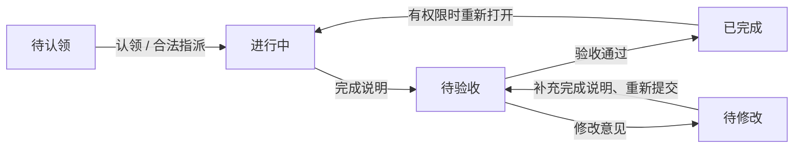

# AgileNest 迭代、视觉与交互设计方案

日期：2026-10-10 · 方案版本：1.1 · 状态：首轮体验方案已实施；实际验收见执行记录

调研基线：本地 `codex/ai-settings-workspace`，应用版本 `0.4.0-rc.4`、提交 `2301a6d`。方案撰写阶段未改业务代码；用户随后授权分步实施与子代理，首轮已在 `codex/experience-integration` 实施，候选版本为 `0.4.0-rc.5`。实际文件、冻结决策与本轮重新验证的证据见 [执行与验收记录](AGILENEST-EXECUTION.md)，下文保留设计目标和后续候选。

配套：[Agent 执行任务卡](AGILENEST-AGENT-BRIEFS.md)。硬约束仍以 [AGENTS.md](../AGENTS.md)、[TEAM.md](TEAM.md)、[IDENTITY.md](IDENTITY.md) 为准。本文是规划，不代表 Sprint、GitHub 集成或 AI 执行已获实现授权；实际开发开始时由集成人登记本轮范围。

## 1. 产品方向与范围

**近期目标：让现有“团队 → 项目 → 任务 → 成果提交 → 验收 → 复盘”成为一条连续、易理解的协作流程。**

中长期可以发展为面向开发团队的敏捷协作平台，形成“需求规划 → 迭代安排 → 执行 → 代码证据 → 验收交付 → 复盘”。当前高校课程、实验室、竞赛场景仍然保留；不把产品经理、开发者两个标签写成新的授权体系。

### 1.1 三种使用视角，共享一份数据

| 视角 | 最想知道 | 默认重点 | 授权来源 |
|---|---|---|---|
| 执行者 | 我接下来做什么，交给谁 | 我负责的、待修改、临近截止、可以认领 | 现有执行能力、负责人关系 |
| 协调者 | 哪些事项无人负责、逾期、影响节点 | 项目任务分布、日期、成员分工 | 管理员或特定项目场景下的队长能力 |
| 验收者 | 哪些成果需要判断，是否满足要求 | 待验收、完成说明、子任务、修改意见 | 管理员或指导老师能力 |

“我的执行 / 待我验收 / 可以认领”是视图，不是账号角色开关。职务可以叠加，一个人可以同时看到多个入口；跨项目逐项算权限，学术身份只展示。协调者不自动拥有验收权限。

### 1.2 当前能力与设计差距

| 能力 | 已有基础（源码/文档） | 本轮设计建议 |
|---|---|---|
| 统一工作台 | `review/views.tsx`、`review/client.ts`；URL 视图与筛选 | 收敛信息层级，把待处理列表放在摘要之前 |
| 项目与成员 | `identity/project-view.tsx`、成员职务与身份确认 | 项目概览说明目标和下一节点；身份徽章与职务分开 |
| 任务规划 | 标题、描述、优先级、日期、预计分钟、子任务、里程碑 | 在现有任务池组织目标与验收要求；暂不称为完整 Backlog |
| 看板/表格 | `board/ui.tsx` 同源任务、筛选、分组、拖动 | 导航合并为“任务”，页内切换三种表达；保留旧路由 |
| 任务详情 | `components/cards/task-drawer.tsx` 与 board 内联 Dialog，两套呈现 | 统一详情骨架，Owner 分别接入，减少同任务不同信息结构 |
| 验收与活动 | 状态、说明、修改意见、事件 | 首屏突出最新待处理意见与下一步，历史次级展开 |
| 工时与贡献 | `worklog/views.tsx`；顶层任务验收完成度 | 标明口径和分母，支持真实任务下钻；不捏造趋势 |
| 日历与节点 | 项目月历/排期、里程碑、本人日程 | 先区分个人与项目；跨视图筛选契约后置到专门迭代 |
| AI | 本地会话、草稿、资料，模型未接入 | 保持明确能力说明，不当作本轮任务主流程 |

### 1.3 范围分层

| 层级 | 内容 | 处理方式 |
|---|---|---|
| 近期体验迭代 | 导航、任务浏览与详情、工作台、验收、统计口径、窄屏反馈 | 按本文任务卡，在用户启动开发后实施 |
| 近期增强候选 | 项目日历共享筛选、统一详情 URL、日期筛选 | 先冻结契约再开发；不是纯 CSS 工作 |
| 路线图 | 真正的 Backlog/Sprint、GitHub、历史燃尽图、AI 执行 | 只做产品规划；实现前更新范围、Owner、数据与契约 |
| 本期不纳入 | 任意自定义流程、甘特、作品集、模板库、Agent API | 继续按 ROADMAP 管理 |

“任务池”当前是已有任务的组织入口；`unclaimed` 只表示无人认领，不能等同于“尚未纳入迭代”。不要通过新增一个任务状态来模拟 Sprint 或需求生命周期。

## 2. 有来源的参考板

以下链接在 2026-10-10 做了网页内容核验。官方文档中的截图可用于理解布局；未下载、移植源码，也没有制作或冒充第三方产品截图。Circle 已确认是可访问的界面演示，未验证其全部交互或源码授权。

| 参考页面 | 看什么 | AgileNest 的取舍 | 负责阶段 |
|---|---|---|---|
| [Circle 演示](https://circle.lndev.me) | 导航、工作项列表、紧凑工作空间 | 借鉴信息密度；不照搬演示数据、状态或品牌 | R1 |
| [Linear 看板](https://linear.app/docs/board-layout) | 列表/看板表达同一组工作项，按属性分组 | 保留 URL 条件；仅状态分组提供合法状态拖动 | R2 |
| [Linear Peek](https://linear.app/docs/peek) | 浏览中快速查看内容 | 提升查看效率；本项目明确按钮/点击入口，不强迫用户掌握快捷键 | R2 |
| [Plane 任务详情](https://docs.plane.so/work-items/work-item-details) | 默认 side peek，描述、属性、子项与历史分层；含真实截图 | 共用详情骨架，下一步操作前置，完整编辑仍有独立页 | R2 |
| [Plane 创建工作项](https://docs.plane.so/work-items/create-and-manage-work-items) | 创建时项目上下文、字段层级、保存反馈 | 必填最少、可选展开；不照搬任意列直接创建对应状态 | R2 |
| [Jira Scrum 模板](https://www.atlassian.com/software/jira/templates/scrum) | Backlog 优先排序、计划 Sprint、报告；含官方截图 | 仅用于下一阶段需求与迭代规划 | 后续 |
| [Plane Cycles](https://docs.plane.so/core-concepts/cycles) | 迭代范围、进度、燃尽/燃起 | 先建立范围历史，再画图；不能用今天的数据还原历史 | 后续 |
| [Linear GitHub 集成](https://linear.app/docs/github) | 任务关联 PR、Commit 与同步状态 | 先只读交付证据；本项目不因合并 PR 自动验收 | 后续 |

这些是参考依据，下面的尺寸、布局、任务卡与交互规则是本项目设计建议，不是上述产品的原样规范。Figma/Dribbble 的泛首页没有明确稿件，不作为 agent 的像素级依据，也不默认存在可编辑源文件。

给执行 agent 的参考阅读顺序：先本项目约束与本方案，再 Plane 详情和 Linear 看板，最后看 Circle 的导航密度。Jira/Sprint 资料不作为近期增功能清单。

## 3. 信息架构与页面职责

```text
AgileNest
├─ 工作台                         /home（保留旧 student/teacher 地址）
├─ 团队空间                       /t
├─ 我的日历                       /calendar
├─ 消息                           /notifications
├─ 当前项目（显示真实项目名）
│  ├─ 项目概览                    /p/[projectId]
│  ├─ 任务                        任务池 / 看板 / 表格页内切换
│  ├─ 项目日历                    /p/[projectId]/calendar
│  ├─ 里程碑                      /p/[projectId]/milestones
│  ├─ 验收                        /p/[projectId]/review
│  └─ 工时与贡献                  /p/[projectId]/stats
├─ AI 草稿                        /ai（模型未接入）
└─ 个人设置                       /settings
```

不因导航收敛删除已有 URL。默认“任务”可指向看板，任务池/看板/表格页头保持同一组视图入口。任务池自身功能与筛选未统一前，先只合并看板与表格入口，避免声称三者已经同源筛选。无项目时展示选择/创建入口，不悄悄把第一个项目当作当前上下文。

| 页面 | 首屏主体 | 主操作 | 次级信息 | 禁止堆放 |
|---|---|---|---|---|
| 工作台 | 按视角排序的待处理任务列表 | 打开任务/继续处理 | 今日截止、待验收数量、项目快捷入口 | 通用欢迎大卡、无口径“健康分” |
| 项目概览 | 项目目标、当前节点、逾期/待修改/待验收事项 | 查看任务；有权限时新建 | 成员、近期活动、里程碑 | 全量任务、全量统计重复铺满 |
| 任务池 | 未认领任务优先；名称、优先级、日期 | 新建/认领/按权限指派 | 描述、预计工时、里程碑 | 伪 Sprint、伪依赖关系 |
| 看板 | 五态任务、负责人和截止日期 | 打开详情/合法流转 | 一行筛选与分组 | 每列塞全部操作按钮 |
| 表格 | 任务、状态、优先级、负责人、截止日期 | 打开详情 | 可用筛选与结果数 | 首轮批量验收、隐藏的批量写入 |
| 验收 | 待验收队列与成果上下文 | 通过/要求修改 | 子任务完成、历史意见 | 一键通过全部、代码合并等于验收 |
| 工时与贡献 | 已验收顶层数/总数、实际分钟、成员投入 | 下钻已有对应任务 | 口径、无数据提示 | 无历史来源的燃尽图/Velocity |
| 日历 | 明确的“我的日历”或“项目日历”标题 | 本人建日程 / 打开项目事项 | 图例、跨天条、里程碑 | 把个人日程混进团队统计 |

## 4. 视觉系统

方向：**安静、紧凑、适合长时间处理任务的工作空间**。参考 Linear 的信息层级与 Plane 的任务上下文，同时保留 AgileNest 的蓝/暖橙品牌。

### 4.1 布局与尺寸（设计目标，实施时在真实视口核对）

| 元素 | 桌面建议 | 窄屏策略 |
|---|---|---|
| 主导航 | 展开 240px；收起 64–72px；账号区域在底部 | <768px 收为顶部菜单，关闭后退出可访问树 |
| 页头 | 56px；面包屑、页面标题、一个主操作 | 允许换行，操作不覆盖标题 |
| 内容间距 | 24px；工作型页面不加大幅居中留白 | 16px |
| 工具栏 | 搜索 + 常用筛选 + 更多条件 + 结果数 | 分两行；已选条件可独立移除 |
| 看板列 | 260–300px；列距 12–16px | 仅看板区域横向滚动，页面本身不横向溢出 |
| 任务卡 | 12px 内边距；标题最多两行，元数据两行内 | 点击区域保留；完整标题在详情可读 |
| 表格行 | 默认 48px；密集方案 40px 仅在桌面 | 保留任务/状态/负责人，其他列可局部横滚 |
| 详情抽屉 | 默认 600–680px；≥1440px 可到 720px | <768px 全屏；头/底操作可见，中间滚动 |
| 正文表单 | 单列最大约 760px；长文内容不要挤进属性小栏 | 单列 |

现有共享详情最大宽度 880px 且内部双栏。推荐试验 640px 单列主体 + 紧凑属性区，使背景任务列表仍能被识别；复杂编辑使用独立页。首轮继续复用 Radix 模态交互，不同时引入非模态分屏和新的焦点规则。

### 4.2 色彩与层级

| 用途 | 已有/建议值 | 用法 |
|---|---|---|
| 主品牌 | `#294a78`，深色沿用 `#92b6e8` | 主要操作、选中、链接、焦点 |
| 暖橙点缀 | `#bf6a34`，深色沿用 `#e6a16d` | 少量强调，不铺满页面 |
| 浅色背景 / 内容面 | `#f5f7fb` / `#ffffff` | 页面与工作面分层 |
| 深色背景 / 内容面 | `#141a23` / `#1b2330` | 沿用主题 token，不单页手写深色 |
| 正文 / 次级文字 | 沿用 foreground / muted-foreground | 次级文字也必须可读 |
| 五态 | 灰 / 蓝 / 琥珀 / 红 / 绿 | 按待认领、进行中、待验收、待修改、已完成映射 |
| 优先级 | 使用 PriorityPill | 状态与优先级都带文字，不能只靠红点 |

保持 `globals.css` 为唯一 token 来源，状态使用 `StatusPill`。深色状态色需要独立检查实际背景上的对比度；不能因为品牌 token 支持深色，就认为所有状态胶囊已合格。对比度作为验收目标：普通文字至少 4.5:1，关键控件边界/焦点至少 3:1。

字体使用现有系统字体，中文回退 Microsoft YaHei / PingFang SC，不为字体加依赖。页面标题 24/32，分区标题 16/24，正文与表格 14/22，辅助文字 12/18；业务关键内容避免 10px。数字使用等宽数字。字重常规 400、强调 500–600。

间距以 4 / 8 / 12 / 16 / 24 / 32px 为阶梯；输入与按钮高 36–40px，触屏有效点击区域约 44px；圆角控制在 8–12px。列表用分隔线，任务用卡片，统计用必要的小摘要；减少卡片嵌卡片。已有 Lucide 图标统一线宽和尺寸，不混用 Emoji 作业务控件。

### 4.3 动效与反馈

- hover/选中 120–160ms，普通面板 180–220ms，抽屉 220–300ms；以调整已有动效为主，不引入库。
- 状态写入等待真实响应；保存按钮显示处理中并防重复提交，成功后刷新相关视图。
- 无缩放弹跳、无持续发光；骨架保持布局尺寸，减少视觉跳动。
- 系统减少动效时关闭位移和缩放；仍显示文字反馈。
- 错误靠近字段或操作区；重要失败不能只出现一闪而过的 toast。成功提示使用已有 FeedbackProvider。

## 5. 关键交互规格

### 5.1 浏览任务与 URL

推荐“列表/看板 → 点击标题 → 详情 → 处理 → 回到原位置”。关闭详情后保留筛选、分组、滚动位置与焦点。

当前看板/表格沿用 `board/client` 的 `parseFilters` / `serializeFilters`，包含 q、status、assigneeId、priority、milestoneId，分组使用 groupBy。工作台沿用 `review/client` 的 view/q/projectId/due。不要直接把两套 query 对象当成同一类型。

建议后续增加详情 query 键 `task`（尚未实现）：打开详情 push URL，切换详情 replace，关闭只删除 task 并保留其余条件；浏览器后退关闭详情，前进恢复。直接访问带 task 的 URL 同样检查项目归属与 ACL；任务被删除/失去访问权限时显示中性提示，不能回显其标题。URL 同步方案先由 A/B/foundation 冻结，不能每个页面自建一个键。

搜索输入使用 replace 更新，避免一个字一次历史记录；视图切换使用导航历史。切项目默认清除 assigneeId/milestoneId/task 等旧项目实体条件；任何保留项必须通过新项目的权限和有效性校验。

### 5.2 任务卡与详情

卡片顺序：标题 → 优先级/负责人 → 截止日期/子任务进度。短编号只做辅助，不取代可读标题；不为了设计稿中的 `AGN-102` 临时添加业务编号系统。

详情结构：

1. 顶栏：任务短编号、项目、完整页、关闭。
2. 标题及状态；“下一步由谁处理”的文字。
3. **当前处理区**：待修改显示最新修改意见，待验收显示最新完成说明；完整文本可展开。
4. 目标与验收要求。现阶段复用 description，明确建议填写“目标 / 验收要求”，不伪装为已存在的结构化字段。
5. 属性：负责人、优先级、开始/截止、预计工时、里程碑。
6. 子任务摘要、已登记工时、活动历史；历史按时间展示操作与操作者。
7. 底部：同源生成的合法操作。动作过多时保留主要动作，次要动作放菜单，删除进入独立确认。

抽屉数据必须与独立页使用同一份业务契约。打开后加载详细数据时不能先把旧任务内容显示为新任务；取消请求或按请求键隔离响应。失败显示重试，主体仍可关闭。活动记录不是通用评论系统；任务附件也不能复用私人的 AI 本地资料作为团队附件。

### 5.3 创建与编辑

- 新建默认当前项目；标题必填，描述/优先级/日期/工时/里程碑按现有 schema 校验。首屏最少字段，其余渐进展开。
- 负责人从真实可执行成员中按姓名选择；缺成员时提示先添加成员或调整职务。不能输入数据库 ID。
- 成功创建后刷新列表并给“查看任务”入口；若当前筛选排除了新任务，明确告知，不偷偷清空筛选。
- 保存失败保留全部输入；日期错误出现在日期字段附近。编辑中取消可放弃未保存改动，有实质输入时先提示。
- 提交期间复用现有等待边界；退出保护与关闭行为一致，不能一个页面静默丢输入、另一个页面永久锁死。
- 不增加自动保存服务、离线队列或任务草稿表。若要做持久草稿，应另列范围。

### 5.4 状态流转：沿用五态



图只表示主要交互路径；完整合法路径与负责人约束以 `tasks/states.ts` 为准，包含退回任务池与再次指派。看板展示顺序为待认领、进行中、待验收、待修改、已完成；不能把待修改画成已完成之后的下一阶段。

| 操作 | 输入/反馈 | 失败与取消 |
|---|---|---|
| 认领 | 显示当前操作者，服务端确认后移列 | 并发已被认领提示刷新；不得覆盖负责人 |
| 指派 | 选择符合执行条件的团队成员 | 不保存无效成员；保留选择与说明 |
| 提交/重交 | 显示当前→目标；完成说明必填 | 空说明不提交，取消保持原列 |
| 打回 | 修改意见必填，展示对应成果说明 | 失败保留意见，卡片不提前移动 |
| 验收通过 | 展示成果、子任务与合法能力 | 子任务未全验收按服务端规则阻止 |
| 重新打开 | 明确任务将回到进行中 | 子任务重开需遵循先重开已完成父任务的规则 |
| 拖动 | 只高亮 availableTransitions 允许目标；需要说明时开同一表单 | 无权限目标不接收，取消/冲突回原列 |

视图可以呈现“由管理员或指导老师验收”，但不得重新复制角色×状态权限表。真正能力仍来自 `capabilitiesFor`、`availableTransitions` 和服务端复核。

### 5.5 验收台、通知与统计

验收台使用队列 + 详情，先处理待验收事项。窄屏先列表，点开全屏详情；完成操作后更新数量，保留当前筛选，不自动验收下一个。通知使用客观文案并直达任务，无法访问的旧任务提供返回消息列表入口。

完成度 = 已验收顶层任务 / 顶层任务总数；子任务进度另算。空项目显示“暂无任务，尚无完成度”，避免 0/0 被读成实际失败或完成。已提交不等于完成，工时不等于价值或绩效。所有摘要标明项目与统计范围。

风险事项仅采用有来源的规则：截止日早于今天且未完成、待修改、待验收。可显示具体数量和任务；不生成“项目健康 87 分”。当前没有完整历史快照时，只展示现状，不绘制历史趋势。

### 5.6 日历与边界状态

项目日历展示项目任务排期/里程碑；我的日历只读写当前账号的日程。个人日程同日 HH:mm、版本冲突 409 与隐私规则保持。个人日程出现在个人视图，并不让团队管理员获得它的读取权限。

| 状态 | 用户应该看到 | 下一步 |
|---|---|---|
| 空项目 | 尚无任务，说明任务用途 | 有权限时新建任务 |
| 筛选无结果 | 已选条件与结果为零 | 清除部分条件/重置 |
| 数据加载 | 与最终内容同尺寸的骨架 | 不显示伪造数量 |
| 保存失败 | 中文错误、保留输入 | 重试/取消 |
| 409 冲突 | “内容已变化，请刷新后重试”及保留的表单文字 | 重新读取，不自动覆盖 |
| 无权限 | 当前操作不可用及可理解原因 | 查看可访问内容或返回 |
| 数据删除/访问失效 | 中性不可用提示 | 返回原列表 |
| 网络慢/断开 | 真实等待或失败状态 | 不显示“已保存” |

## 6. 迭代顺序与验收门槛

以下工作量是便于安排的粗估人日，假设复用现有组件、无新依赖/迁移，不是交付日期承诺。多人协作仍需给契约、合并与回归留时间。

| 阶段 | 目标与交付 | Owner | 前置 | 粗估 | 退出条件 |
|---|---|---|---|---|---|
| R0 基线 | 真实界面截图、能力核对、范围/契约清单 | foundation 统筹、各 Owner 核对 | 无 | 1–2 人日 | 确认本轮页面、数据来源和验收脚本 |
| R1 统一外壳 | 导航收敛、页头/工具栏/反馈规范、深浅主题 | foundation | R0 | 2–3 人日 | 1440/1024/390 宽度及键盘可用，旧 URL 可访问 |
| R2 任务完整体验 | 创建→浏览→详情→提交/打回/重交；共用详情骨架 | A + B + foundation | R1，详情契约冻结 | 4–6 人日 | 数据与按钮一致、取消/失败不移列、URL/焦点恢复 |
| R3 协作收尾 | 三种使用视角、验收队列、统计口径、日历和通知上下文 | C + D + E | R2 的任务入口 | 3–5 人日 | 混合职务正确、数字可追溯、个人日程隔离 |
| R4 集成发布 | 全链路回归、Windows 构建与发布检查、版本说明 | foundation + 各 Owner | R1–R3 | 1–2 人日 | 自动检查和手工证据齐全，再统一升版 |

总计约 11–18 人日；新发现的业务缺陷与跨日历筛选契约可增加工作量。时间紧时先完成 R1 + R2，R3 中日历统一筛选作为第二次独立交付，不能牺牲权限、状态一致性与错误反馈。

示意依赖：R0 → R1 → A 详情内容 / foundation 容器 → B 看板与表格接入 → C/D/E 消费入口 → R4。C/D/E 可提前准备各自页面，但不能依赖未确认签名写临时副本。

版本由集成人按 [WORKFLOW.md](WORKFLOW.md#9-迭代版本与发布) 统一递增。首轮沿用同一 `0.4.0` 目标，候选编号递增至 `rc.5`；正式版仍需合入主分支后重新验证。本文的后续路线图不构成应用发布或实现授权。

## 7. 后续敏捷产品方向（仅概念规划）

以下依赖链用于判断产品走向，不分派实施任务。落地前先更新 ROADMAP、Owner 和 AGENTS 范围。不要据此新增路由、数据表、假控件或模拟业务。

| 后续阶段 | 页面与价值 | 必须先解决的设计问题 | 验证目标 |
|---|---|---|---|
| F1 需求与 Sprint | 规划页左侧需求列表，右侧选定迭代；详情复用任务呈现 | 需求是否独立实体、迭代目标/日期、纳入/移出、关闭后未完成项、并发版本、排序权限 | 用户能安排一轮工作并解释范围变化 |
| F2 代码证据 | 任务详情增加“关联代码”，展示 PR/分支/构建及来源 | 仓库归属、平台与 GitHub 身份映射、可见性、同步失败、Webhook 幂等、重放与授权 | 能从任务追溯真实 PR，不自动绕过人工验收 |
| F3 交付分析 | 迭代报告：范围变化、剩余工作、完成趋势、复盘 | 基线快照、成员范围变化、估算单位、时区、未估算项、删除/重开、数据保留 | 每个图上数字可追溯且历史不随今天编辑漂移 |
| F4 AI 辅助 | 拆解建议、总结、风险解释，先预览再应用 | 数据读取范围、来源引用、人工确认、审计、失败补偿、模型配置 | 建议可解释；当前本地草稿不被误认为已执行 |

推荐先把 Sprint 作为任务的计划容器，不改变任务五态。保留“业务验收完成”的含义；代码评审与业务验收是两个判断维度。首期只读 PR 证据优先于双向同步，先把来源与失败状态做准确。

燃尽图初版可使用“剩余顶层任务数”，标注范围变化；若将来改用估算值，则必须保持同一图单位一致，不能把故事点和分钟相加。当前 estimatedMinutes 是预计投入，不是可靠的每日剩余量。Velocity 和周期时间要先写清样本与起止事件，没有历史数据时显示“开始积累数据”。

通用评论、团队附件、任务依赖也属于独立产品能力，需明确数据、权限、删除与历史策略，不能从 Plane 的界面参考直接复制成当前承诺。

## 8. 可操作的验收脚本

创建专用演示团队与项目，使用测试/演示账号，不改真实团队或历史业务数据。自动测试使用 `.env.test` 和 `agilecampus_test`，禁止对开发库调用 resetDb。

1. 空账号从团队入口创建/加入；新建项目后能到任务入口，名称与上下文一致。
2. 执行成员创建任务，错误日期被拒绝且输入保留；成功后能从通知反馈打开任务。
3. 搜索与按负责人筛选，切看板/表格、刷新、前进后退，条件保留；无结果能重置。
4. 打开任务详情、关闭、再打开；原筛选与焦点恢复。若实现 task query，再验证直接链接/后退。
5. 认领→提交完成说明→指导老师打回→负责人重交→验收通过，详情、列表、活动一致。
6. 拖入待验收/待修改并取消；空说明；服务端 409；卡片均不提前移动。
7. 两个账号同时认领同一任务，只能一方成功；另一方收到可恢复反馈。
8. 纯队员不能验收他人任务；实验室/竞赛队长可合法指派，课程队长不越权；多职务按并集。
9. 父任务仍有未验收子任务时不能验收；完成父任务下的子任务重开遵循现有规则。
10. 工时登记后统计刷新；子任务不重复计入项目完成度。零任务/零工时均有准确空状态。
11. 他人日程不能访问；旧版本修改返回 409；个人日程不改变项目任务。
12. 消息直达正确任务；删除或访问变化后的旧链接不泄漏内容；未读状态按既有契约刷新。
13. 1440×900、1024×768、390×844；额外检查 320px 极窄宽度、长中文标题、长姓名、空说明。
14. 全程键盘可操作；弹窗限制焦点、Esc 分层关闭并返回触发按钮；拖拽有按钮等价路径；减少动效有效。
15. 深浅主题中核对文字、状态、错误、禁用与焦点，不能只检查普通卡片。

每个改动模块保留 ≥6 条有意义的契约覆盖（正常路径、越权、非法状态及相关边界），实现后执行完整 `npm test`、Windows `npm run build` 与 `git diff --check`。数据库不可用时按仓库要求运行纯函数子集，并明确“未完成完整验证”，不得记为发布通过。

交付证据：每页至少默认/空状态/错误截图，关键页桌面+窄屏；一个完整验收闭环记录；测试与构建结果；契约变动表；本轮未覆盖项。可用性目标为“不借助讲解找到下一步，主要任务从工作台到操作不超过三次入口跳转”；这是待验证目标，不是已测得指标。

## 9. 本轮设计预览与核验范围

配套 `docs/design/agilenest-preview.html` 是会话内设计示意的源片段，包含固定的六项示例任务；可切换执行/验收关注、列表/看板、搜索和任务详情，不请求业务接口，也不写入任务。它不是生产页面或可直接复制进项目的组件。

为便于在会话中阅读，示意的窄屏看板按列堆叠，详情作为内容区展开；实际产品的局部横向看板、全屏模态详情按第 4–5 节实施。侧栏中只有工作台/项目任务参与演示，其他标签只说明导航层级。

概念示意交付时已检查：脚本语法、执行/验收关注各两项任务、项目六项任务及五态数量、任务详情和 Esc 关闭、搜索无匹配及清空恢复、桌面呈现、390px 视口中的窄屏布局。预览内层内容实际宽 343px、滚动宽相同，详情宽 308px、滚动宽相同；这些数字只描述设计示意。真实应用的实现、测试、构建与页面证据另见执行记录，不以概念示意代替应用验收。
