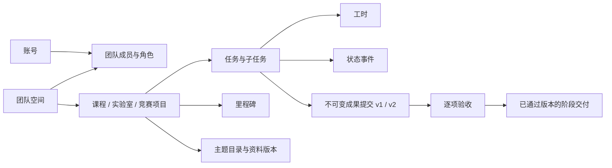
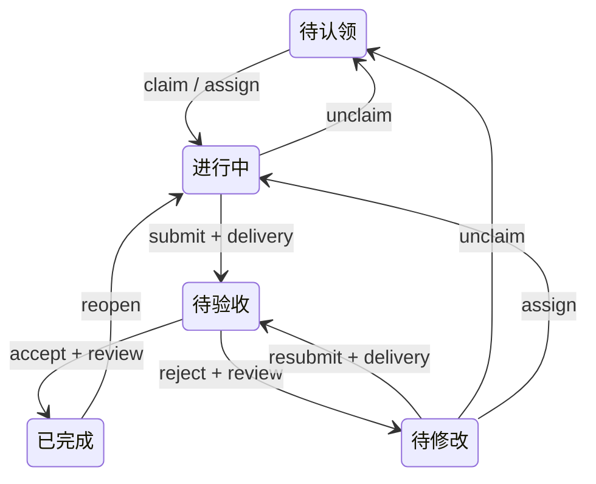

# 协作链路与状态机 · v0.5

AgileNest 面向通用项目协作，兼容高校课程设计、实验室课题、竞赛与混合团队。团队聚集成员，项目承载目标，任务承载可交付工作；研究报告、课程材料、设计文件与代码都可以成为成果，GitHub 只是可选链接。实验室采用团队 + lab 类型项目；通用团队/项目资料由 resources 管理，不新增实验专属数据或设备模型。当前 0.5.0 实施与验收进度见 [协作工作区](COLLABORATION-WORKSPACE.md) 和 [UX](UX.md)，本页规则不等于全部 GUI 已验收。

## 数据与导航链路

项目访问权限继承团队成员关系；用户在不同团队内的职务可以不同。邀请码加入默认组员，管理员独立授予可叠加职务，学术身份不授予权限。团队空间展示成员与 active 项目数量，项目卡片展示顶层任务状态分布，完成度为已验收顶层任务 / 顶层任务总数；无顶层任务时明确展示零项。

| 页面 | 用途 |
|---|---|
| /t | 团队卡片，创建/加入与上手路径 |
| /t/[teamId]/projects | 项目与课题卡片、类型筛选、创建项目 |
| /t/[teamId]/members | 成员卡片、角色说明与管理员调整入口 |
| /p/[projectId] | 项目概览，指向看板、任务池、个人任务/验收台 |
| /p/[projectId]/board | 五态看板、合法拖拽与详情侧栏 |
| /p/[projectId]/table | 同一数据的表格视图，保留筛选 |
| /p/[projectId]/tasks | 同源筛选的任务池，发布与认领 |
| /p/[projectId]/tasks/[taskId] | 状态路径、说明、子任务、工时与活动记录 |
| /t/[teamId]/resources · /p/[projectId]/resources | 团队/项目资料、分类主题、文件夹、评论与回收站 |
| /p/[projectId]/delivery | 已通过成果的阶段清单、评审问题、归档与记录导出 |
| /home · /home/student · /home/teacher | 按当前项目职务分类的统一工作台，兼容原入口 |
| /settings | 姓名、简介、头像、学术身份与飞书绑定 |
| /notifications | 本人消息、未读筛选与对应任务入口 |

## 五态唯一真相

`assign` 也允许在进行中重新指派负责人。只有 `accepted` 是已完成；提交不直接完成。待修改是验收反馈分支，修改后回到待验收。状态代码与数据库 enum 保持兼容。

模块内部 `tasks/states.ts` 的 `TRANSITIONS` 是唯一合法边集合。`availableTransitions(task, role, actorId)` 使用任务权限快照与负责人判断；`ACTION_ROLES` 仅保留旧调用兼容。任务权限来自 `identity/client.capabilitiesFor` 按职务并集与项目场景计算。界面、看板与服务端复用公开规则，服务端重新核对当前权限。

## 动作与职务

学术身份不参与授权。管理员、副管理员、指导老师、队长、组员可叠加；完整能力矩阵见 [IDENTITY.md](IDENTITY.md)。指导老师负责验收，叠加组员后可以执行自己的任务；队长协调实验室/竞赛的指派和项目维护，验收仍由管理员、副管理员或指导老师执行。

负责人选择具有执行职务的真实团队成员。提交/重交必须验收清单、完成说明、验证结果、证据和逐项自检；验收绑定当前提交版本，打回要求未通过项的问题位置与通过条件；创建时指定负责人同样校验，普通组员不能通过创建接口指派别人。成员查询也在 service 中检查访问权限。职务调整锁定团队，禁止降级最后一位管理员。

发布任务至少一项非空、可核对的验收标准，与任务同事务保存，不新增第六个草稿状态。历史任务缺标准时明确提示先完善，不能伪造旧要求。任务处于 submitted/accepted 时冻结验收要求；打回或重开后可持版本调整，新提交使用新要求，原提交和评审快照保留。

每次 submit/resubmit 产生独立递增版本，保留当时说明、验证、链接/文件和自检。未达到项可在自检中如实记录；accept 必须核对当前提交快照且全部项通过，reject 记录具体修改要求。历史 v1/v2 选择仅改变阅读对象，不改变操作区的当前待验收版本；旧 submissionId 返回冲突，不能验收历史选择或覆盖新版。

任务最多两层，创建后不能更换父任务。待验收或已完成的父任务不能继续拆分；验收父任务前需全部子任务通过，重开已完成子任务前需先重开父任务。父任务行锁协调子任务写入与验收，避免并发更新产生相互矛盾的完成状态。项目完成率只统计顶层任务，子任务进度在详情独立展示。

## 写入与刷新

`transitionTask()` 是所有既有任务状态变更入口：先检查项目访问和能力，在事务内先锁团队并重查成员资格，再按需锁父任务与当前任务，读取最新状态并查表，最后同时写成果/评审、任务与活动事件。并发认领会让后一请求看到新的状态并返回 409；资源证据按固定顺序锁定并绑定引用。通知失败不撤销已提交的任务操作。

看板移动通过 `moveTask()` 调用任务公开契约；普通动作仍兼容 `note`，提交/重交传 `delivery`，通过/打回传 `review`，不能用文字绕过结构化校验。状态、负责人和普通属性分别提交，混合写入明确拒绝，避免静默丢弃字段。页面在服务端确认后更新；取消或失败仍留在原列。

Server Actions 刷新实际任务所属项目的页面，包含看板、表格、详情、验收台与工作台。任务详情同时校验 URL 中的 projectId 和任务真实归属。活动记录可追踪操作人、动作、说明，不宣称具有不可篡改存证能力。

## 多视图与实现边界

任务池、看板与表格共用 URL 筛选 `q/status/assigneeId/priority/milestoneId/labelId/blocked`，`groupBy` 控制分组；本人保存视图保留合法条件，分享链接不扩权。看板与表格 `task=UUID` 保留当前详情和筛选，关闭只移除详情参数，浏览器前进/后退可恢复。API 列顺序继续保持原有契约，页面将待修改放在已完成前；主路径图单独展示验收反馈分支。负责人/优先级/里程碑分组用于浏览，只有状态分组支持拖动。

路由只做组合壳；模块的 service、actions、ui、views 分别负责权限业务、边界写入、客户端交互和服务端组装。业务跨模块只用根契约，公开 UI 入口登记于 [TEAM.md](TEAM.md)，客户端纯函数不导入 DB/session。登录链路与依赖保持既有内容，身份、职务及个人资料表只追加；既有数据库使用文档中的可重复迁移升级。

视觉恢复品牌 `#294a78`、点缀 `#bf6a34`，状态统一用 StatusPill。弹窗使用已有 Radix，拖动复用已有 dnd-kit；提供按钮等价入口、焦点管理与减少动效。完整交互规则、参考来源与手动验收见 [UX.md](UX.md)。

## 学术身份与叠加职务

已实现本科生、硕士生、博士生、老师身份信息与按团队确认；管理员、副管理员、指导老师、队长、组员可叠加，权限按职务和项目场景决定。资料更新需要重新确认，队长协调实验室/竞赛，不独立验收。规则见 [身份与权限](IDENTITY.md)，来源与取舍见 [PR 调研](PR-RESEARCH.md)。

## 分类主题、资料与回收

团队/项目空间内先选资料分类，再创建主题与子文件夹；目录最多八层，同空间同分类移动，校验循环和整个子树深度。当前路径新建/上传同步保存位置，文档版本、文件原件、引文评论与任务来源分别保留；收到深链接不增加读取或管理权限。

资料回收使用版本检查，原件和历史仍保存，回收内容从普通列表、预览、下载和新增关联中隔离。成果、讨论和任务来源等引用保护先检查，不能用回收绕过证据保留。作者或有资料管理能力的成员恢复同一资料及原路径；已恢复或旧版本操作返回 409。目录只能空目录删除，未实现递归回收、永久清除或自动过期。

## 阶段交付与统一协作入口

delivery 组合任务公开的已通过版本，保存责任人、日期、检查项、评审问题与记录快照。绑定时检查任务所属项目、accepted 状态及真实通过的 submissionId；阶段确认再次核对绑定版本、清单和未解决问题。阶段状态与任务五态分开，归档/恢复不替代任务验收；Markdown/JSON 导出指定交付记录版本，不重写旧任务成果。

消息与 AI 草稿统一右下角协作入口。本人消息按真实未读、类别与来源呈现，短时气泡只是预览，消失不自动已读；关闭预览仍可在通知偏好恢复。确认/取消使用既有 Radix 原语，等待、错误、Esc 和焦点恢复要求见 [前端指南](FRONTEND-DESIGN-GUIDE.md)。站内通知不等于飞书投递或系统 Web Push；AI 仅本人本地草稿，Marker 仅导入真实转换产物，未运行 OCR/模型。

## 个人时间安排

个人日程与项目任务分别建模：`personal_schedules` 归本人，项目日历来自任务截止与里程碑。个人日程不触发认领、提交、验收或工时，不向他人发送安排；本人可显式启用日程提醒。添加和编辑不会隐式改变任务。查询限定账号和自然月，以用户/日期索引支撑；编辑和删除使用递增版本与用户条件原子写入，冲突返回 409。路由、页面和 API 复用 calendar 公开契约，边界详见 [SCHEDULES.md](SCHEDULES.md)。

## 任务组织与文档来源

依赖使用同项目有向无环关系，blockedBy/blocking两端可见。前置任务未验收时，availableTransitions隐藏提交/重交/通过，transitionTask事务内再核对；后续已提交或验收时保护前置重开。关系存在时删除不能绕过依赖，五态定义不变。

文档/会议行动项要求可读真实文档和当前来源版本，摘录必须在正文中；任务、创建事件和来源快照同事务提交，稳定requestKey防重复。源文档版本、标题、摘录与回链保留，来源引用保护删除。编辑文档不会改写已创建任务或既有提交版本。

内容协作使用版本409，讨论与正文评论的提及保存姓名快照，结构性解决/撤回保留旧快照。关注/通知事件记录同事务并幂等；个人日程提醒的收据按日程版本和提醒版本唯一。实时编辑和群聊协议是独立后续方案，不用普通全文覆盖实现。
