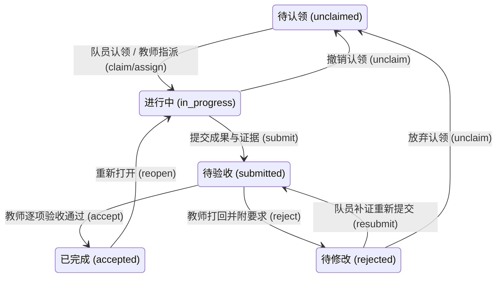

# AgileNest 前端设计与交互优化指南

> 本指南系统梳理了 AgileNest（高校敏捷协作平台）的前端架构、视觉系统、状态机交互模型、组件规范与响应式体验标准。供团队成员、评审者与后续编码 Agent 遵循。

本文件包含设计标准与当前实现说明。最新协作方向以飞书为主、GitHub 为研发补充；项目路径、任务讨论/附件、资料筛选和右下角助手见 [协作执行计划](COLLABORATION-WORKSPACE.md)。实际能力和检查范围以 [文档提炼与执行计划](PROJECT-STATE.md)、TEAM、BUSINESS-COMPLETION 为准；对比度、全键盘与多端标准是最终综合验收目标，不据此宣称已全部实测。

右下角助手复用品牌 tokens、共享按钮和反馈组件，消息与 AI 草稿使用同一容器，避免两个悬浮窗同时遮挡操作；任务/资料模态详情层级更高。机器人使用自有 SVG，提供未读角标、可收起提醒、轻量开合与悬停动效，遵循系统减少动画偏好。通知显示真实数据与失败重试，不填模拟消息或成功结果。

---

## 目录

1. [设计理念与整体架构](#1-设计理念与整体架构)
2. [设计系统与视觉语言（Design Tokens）](#2-设计系统与视觉语言design-tokens)
3. [状态机驱动的交互模型（State-Machine Interaction）](#3-状态机驱动的交互模型state-machine-interaction)
4. [视图一致性与 URL 状态同步（Multi-View & URL State）](#4-视图一致性与-url-状态同步multi-view--url-state)
5. [核心组件与交互模式规范（Components & Patterns）](#5-核心组件与交互模式规范components--patterns)
6. [移动端与无障碍优化（Mobile & Accessibility）](#6-移动端与无障碍优化mobile--accessibility)
7. [防错设计与工程健壮性（Defensive Frontend Engineering）](#7-防错设计与工程健壮性defensive-frontend-engineering)

---

## 1. 设计理念与整体架构

AgileNest 针对高校场景（课程设计、科研实验室课题、大学生创新创业竞赛）量身定制。高校协作呈现出高频迭代、师生层级明确、任务与可交付成果紧密挂钩的特点。

### 1.1 核心灵感与设计定位

- **Plane 启发**：分层详情组织、团队/项目文档中心、工作项活动流追踪，让任务不仅是一个待办事项，而是承载验收标准、文件证据与修改反馈的完整闭环。
- **Linear 启发**：极简高效的视觉密度、键盘优先交互、统一筛选条件跨视图透传、即时反馈与无冗余感知。
- **高校敏捷特色**：双端工作台（队员执行视角 vs 教师/管理员验收视角；队长协调视角），多角色职务叠加计算，学术身份与项目执行权限严格解耦。

### 1.2 前端工程分层架构

```
src/
├── app/                  # Next.js 路由层（只做组合壳，调用模块 ui/views，严禁直接堆砌业务逻辑）
├── components/ui/        # 基础 UI 原语（Radix Primitives + Tailwind，Button, Dialog, StatusPill 等）
├── modules/
│   ├── <m>/
│   │   ├── client.ts     # 浏览器安全的纯函数、URL 序列化与纯 DTO 类型（严禁引入 DB/session）
│   │   ├── ui.tsx        # "use client" 交互组件
│   │   ├── views.tsx     # 服务端装配组件（接收 SSR 数据并聚合模块 UI）
│   │   └── index.ts      # 模块公开契约 Barrel（对外唯一稳定入口）
```

---

## 2. 设计系统与视觉语言（Design Tokens）

视觉系统恢复经典学术沉稳与现代科技感相融合的质感，拒绝浮夸阴影与无效装饰。

### 2.1 色彩体系（Color Tokens）

AgileNest 采用深浅双主题原生自适应，主题与状态色在 `src/app/globals.css` 中以 CSS 变量形式定义：

| 变量 / Token | 浅色模式值 | 深色模式值 | 场景与语义 |
|---|---|---|---|
| `--brand` | `#294a78` (深海蓝) | `#92b6e8` | 主品牌色、激活导航、主按钮 |
| `--brand-accent` | `#bf6a34` (暖琥珀) | `#e6a16d` | 点缀强调、高优先级引导、特别提醒 |
| `--background` | `#f5f7fb` | `#141a23` | 全局页面底色 |
| `--card` | `#ffffff` | `#1b2330` | 卡片、面板、抽屉容器底色 |
| `--muted` | `#f4f4f5` | `#242e3c` | 次级按钮背景、边框分界、表格偶数行 |

### 2.2 状态语义色（Task Status Tokens）

五态状态机与状态标签 `<StatusPill>` 具备统一的视觉识别规范：

```
[待认领 unclaimed]    冷灰 Slate    bg-slate-100 text-slate-700   (等待成员领用)
[进行中 in_progress]  品蓝 Blue     bg-blue-100 text-blue-700     (正常开发中)
[待验收 submitted]    橙黄 Amber    bg-amber-100 text-amber-800   (已交付等待审查)
[待修改 rejected]     红珊瑚 Rose   bg-rose-100 text-rose-700     (审查打回需补正)
[已完成 accepted]     翡翠绿 Emerald bg-emerald-100 text-emerald-800 (教师验收通过)
```

### 2.3 字阶与排版（Typography & Metrics）

- **代码与数据**：统一使用等宽字体（`font-mono`），如版本号、文件体积、工时。
- **标题体系**：
  - 页面级一级标题：`text-2xl font-bold tracking-tight text-foreground`
  - 模块/卡片级二级标题：`text-lg font-semibold text-foreground`
  - 属性标签/辅助说明：`text-xs font-medium text-muted-foreground`
- **动态过渡时间**：
  - 抽屉与侧栏滑动：`220–300ms，具体沿用 globals.css 的已有过渡`
  - 输入框与按钮高度过渡：`180ms ease-out`
  - 必须响应系统的 `@media (prefers-reduced-motion: reduce)`，在用户开启减弱动画时将 transition 归零。

---

## 3. 状态机驱动的交互模型（State-Machine Interaction）

任务流转严格遵循“状态机唯一真相”原则，任何前端交互行为均需与服务端状态流转表同源。

### 3.1 五态流转与操作权限



### 3.2 交互按钮与拖拽的同源规则

- **可用动作计算**：前端按钮与看板允许拖拽的目标列，一律由 `availableTransitions(task, role, actorId)` 纯函数计算，禁止在 UI 内部写死角色与按钮的对应表。
- **弹窗守卫机制**：拖拽或点击触发以下动作时，必须弹出确认/表单弹窗补充必要字段，禁止直接静默变更：
  - `submit` / `resubmit`：必须填写完成说明、验证结果，并提供成果证据（链接或文件）；
  - `reject`：必须填写修改意见，并对验收项打标记；
  - `assign`：必须从具有执行资格的团队真实成员中选取姓名；
  - `reopen` / `unclaim`：显示确认提示，防止误触。
- **取消与失败零副作用**：
  - 用户在弹窗中点击“取消”或按 Esc，不发请求，卡片保留在原列；
  - 服务端返回 409（并发冲突）或 400（参数缺失）时，不提前移动卡片，在就近区域展示可理解的中文错误提示，引导用户刷新或修正。

### 3.3 成果不可变版本与逐项验收机制

在 AgileNest 0.4 体系中，任务验收不是简单的“通过/拒绝”勾选，而是完整的证据链条：

1. **验收标准设定**：具有任务维护权限的成员可定义 `criteria: { id, text }[]`（例如“关键输入和异常用例通过”、“文档已提交”）。
2. **结构化提交快照**：
   - 队员提交时，生成包含当时的验收项快照、完成总结、测试验证说明、成果链接（HTTP/HTTPS，禁止嵌入账号凭据）和关联资料文件（ResourceIds）的不可变 Submission 版本（v1, v2, ...）。
3. **逐项审查（Checklist Review）**：
   - 教师/管理员审查时，必须对每个 Criterion 逐一确认（Passed: true/false）；
   - 仅当所有项均满足时才允许执行 `accept`；
   - 若某项不合格，教师执行 `reject`，修改意见与打回项快照随 Submission 记录归档，供后续追踪。

---

## 4. 视图一致性与 URL 状态同步（Multi-View & URL State）

高效的研发工作流要求视图与筛选条件保持高内聚与可共享性。

### 4.1 URL 即唯一状态源（Single Source of URL State）

在 `/p/[projectId]/board` 与 `/p/[projectId]/table` 之间切换时，URL 搜索参数完整保留：

- `q`：文本搜索关键字（匹配标题与描述）
- `status`：状态多选数组（如 `status=in_progress&status=submitted`）
- `priority`：优先级多选（`high`, `medium`, `low`）
- `assigneeId`：负责人 UUID 过滤
- `milestoneId`：关联里程碑过滤
- `groupBy`：看板分组模式（`status`, `assignee`, `priority`, `milestone`）
- `task`：当前打开的任务详情 UUID（深链参数）

### 4.2 任务详情统一抽屉与焦点管理

- **深链访问**：看板/表格视图下，URL 中带有 `?task=<id>` 时，页面直接挂载对应的 `TaskDrawer`；分享该 URL 给协作者可直达该任务。
- **无障碍焦点环路**：
  1. 用户点击任务卡片或表格标题时，记录当前触发元素 `triggerRef`；
  2. 抽屉打开，自动将焦点移动至抽屉内的可交互首项（关闭按钮或标题）；
  3. 用户按 `Esc` 键或点击遮罩关闭抽屉时，URL 清除 `task` 参数，同时通过 `triggerRef.focus()` 将焦点精准归还原按钮，避免键盘用户的焦点迷失。

---

## 5. 核心组件与交互模式规范（Components & Patterns）

### 5.1 表单交互与安全守卫

- **姓名指派**：严禁向用户暴露底层数据库 UUID。指派组件必须展示成员的真实姓名、角色徽章（当前列表不额外承诺未查询的任务数量）。
- **防脏写与提交保护**：
  - 表单正在提交时，所有操作按钮统一附加 `loading` 状态并处于 `disabled`；
  - 表单提交出错时，保留用户已输入的内容，绝不允许清空表单强迫用户重填；
  - 字段级即时校验（Zod client validation），超出字数（如说明最多 5000 字）即时标红警示。

### 5.2 资源与文档管理（Resources Module）

- **资料类型区分**：
  - 结构化文档：Markdown、Text、CSV、JSON —— 提供内联高亮、CSV 表格可视化与 可折叠 JSON 结构；
  - 附件文件：PDF、图片 —— 浏览器预览与鉴权下载；Office/ZIP —— 保留原文件下载，不假装已经提取正文。
- **引用锁定（Reference Lock）**：
  - 资源一旦在任务成果提交（Submission）中被引用，系统自动建立引用关联，删除按钮置灰并提示“该文件已被任务提交作为证据引用，禁止删除”。

### 5.3 空状态与全局反馈

- **空状态（Empty States）**：
  - 禁止展示“暂无数据”等生硬文字；
  - 复用现有 EmptyState 的真实 props 或等价共享展示，提供标题、说明和具体操作入口，始终指引下一步具体操作。
- **反馈系统（Feedback）**：
  - 采用局部内嵌 `<FormFeedback message="..." />` 与全局轻提示（Toast/Notice）相结合；
  - 操作成功绿色高亮，操作受阻清晰给出业务原因（例如“请先验收全部子任务，再验收父任务”）。

---

## 6. 移动端与无障碍优化（Mobile & Accessibility）

### 6.1 移动视口适配基准（390×844）

在移动端设备上（如 iPhone 12/13/14 典型的 390px 视口），遵循以下布局规则：

1. **局部横滚，杜绝整页溢出**：
   - 看板多列与复杂表格外层必须施加 `overflow-x-auto`，内层卡片设最小宽度（如 `min-w-[280px]`），布局使用 min-w-0，横滚限制在看板/表格容器，避免隐藏内容来掩盖溢出，严禁移动端出现左右摇晃；
2. **操作区保持可见**：
   - 任务详情抽屉在移动端全屏展开，底部操作按钮（认领、提交、验收等）采用固定头/底与中间滚动的 flex 布局；提交/验收弹窗内部可滚动，确保小屏下核心操作始终位于拇指舒适区；
3. **导航抽屉化**：
   - 全局侧栏在 `<768px` 时自动收起为汉堡菜单抽屉，打开时锁定页面背景滚动，按 Esc 键或点击遮罩返回。

### 6.2 无障碍（A11y）准则

- **色彩对比度**：正文文字与背景色对比度严格达到 WCAG AA 级（≥ 4.5:1）；
- **ARIA 语义标记**：
  - 状态胶囊提供可读文字；动态操作反馈使用 role="status"，避免所有静态标签同时播报；
  - 模态弹窗具备 `aria-modal="true"`，并用 `aria-labelledby` 绑定标题 ID；
- **全键盘可操作**：Tab 键循环在弹窗内部受限（Focus Trap），不允许 Tab 键焦点跑到弹窗背后的不可见元素。

---

## 7. 防错设计与工程健壮性（Defensive Frontend Engineering）

### 7.1 严格类型与边界控制

- 全工程开启 TypeScript `strict: true`，禁止使用 `any`；
- 所有跨模块 UI 数据交互必须通过 `@/modules/<m>/client` 的公开 DTO 类型；
- API 请求与用户输入在入口处统一通过 Zod Schema 进行严格校验。

### 7.2 客户端存储容错与偏好重置

- **账号隔离存储**：本地草稿与主题偏好存储 key 必须拼接 `userId`（如 `agilenest:preferences:v1:<userId>`），防止多用户在同一浏览器切换时发生数据串扰；
- **损坏容错与一键重置**：如果 localStorage / IndexedDB 中的偏好数据因版本升级或异常写入导致解析失败，UI 自动提供“重置偏好”按钮，安全移除脏键并回退默认值，而不是导致白屏抛错；
- **多标签同步防覆盖**：若同一草稿在多个标签页中被打开，当一方保存后，未编辑标签页自动静默同步最新正文；正在输入的一方以当前用户键入为准，杜绝旧文本回写覆盖。

---

*AgileNest 前端规范由 foundation 与各模块 Owner 共同维护，修改核心规范请同步更新本文档与对应契约测试。*
